<p align="center">
  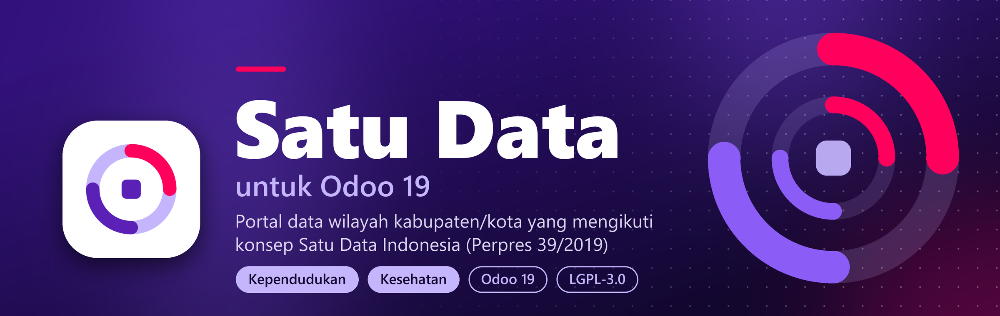
</p>

<p align="center">
  
  
  
  
</p>

# Satu Data untuk Odoo 19

Portal data wilayah tingkat kabupaten/kota yang mengikuti konsep **Satu Data Indonesia**
(Perpres 39/2019): standar data, metadata, kode referensi, serta pembagian peran Produsen Data,
Walidata, dan Pembina Data. Dibangun untuk Odoo 19 Community, seluruh antarmuka berbahasa Indonesia.
Contoh data demo memakai Kabupaten Jember.

Sistem hanya menyimpan **angka rekap per wilayah**, tidak ada data perorangan.

Selain dashboard internal, tersedia **portal publik** (tanpa login) yang menyebarluaskan data yang sudah
diterbitkan Walidata: katalog Daftar Data, dashboard tematik, unduhan CSV/Excel/JSON, API baca, dan
formulir permintaan data.

## Tampilan

Seluruh angka pada tangkapan layar di bawah adalah **data demo fiktif**, bukan data resmi.

### Portal Publik
Beranda portal dengan pencarian, ilustrasi alur data (perangkat daerah → satu pusat data → portal publik),
dan angka kunci. Warna portal mengikuti palet logo aplikasi dan bisa diubah lewat penyunting website.

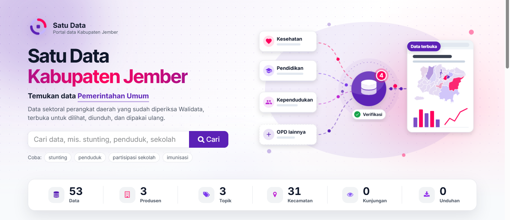

Katalog Daftar Data dengan pencarian dan saringan Produsen Data, topik, urusan, dan tahun.

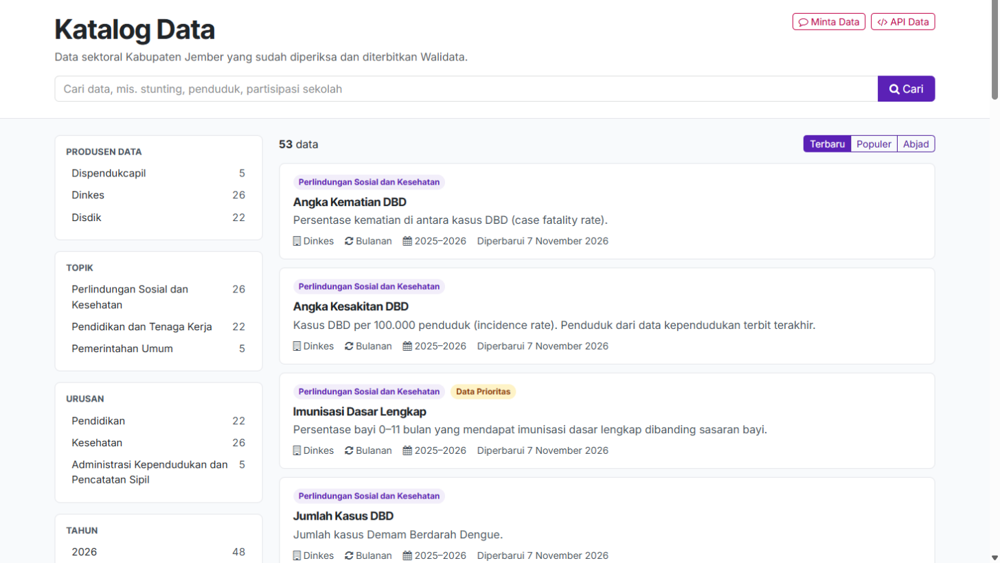

Halaman satu data memuat grafik perkembangan dan sebaran per kecamatan, tabel per periode, metadata
selaras data.go.id, serta unduhan dan alamat API.

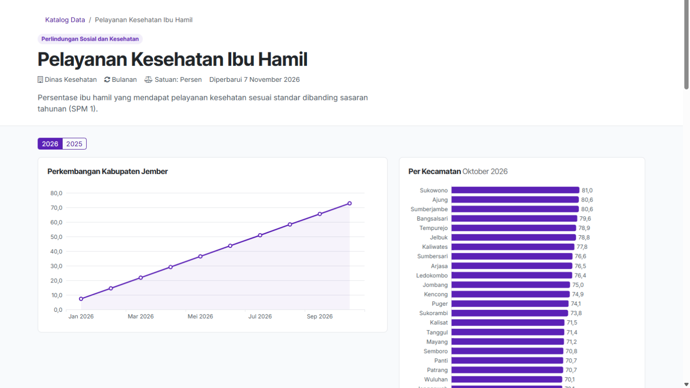

Dashboard tematik publik per topik: peta kecamatan, angka kabupaten, perkembangan, dan peringkat.

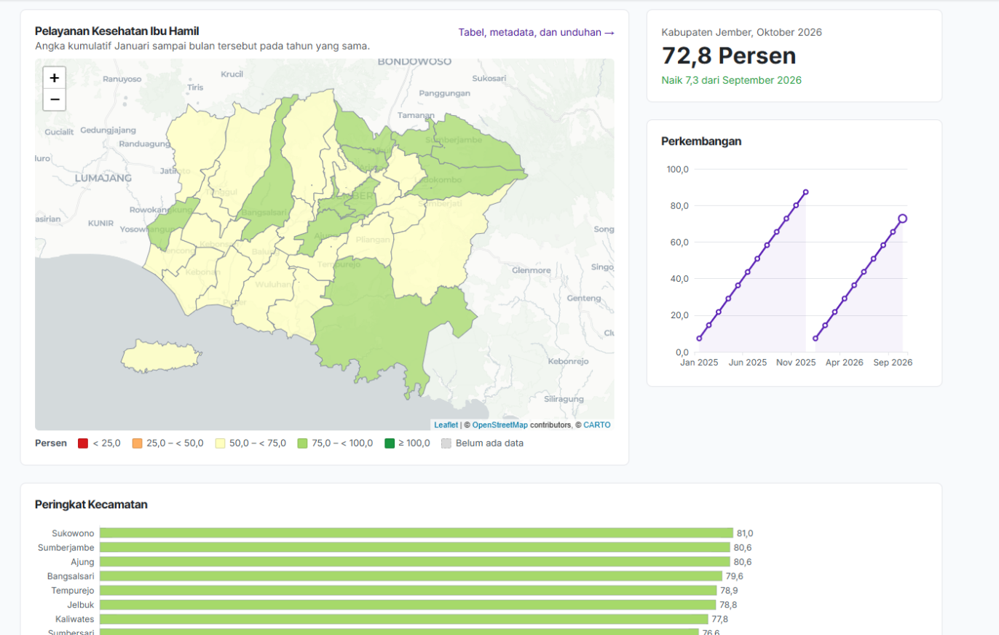

Formulir permintaan data untuk data yang belum tersedia atau kunci API.

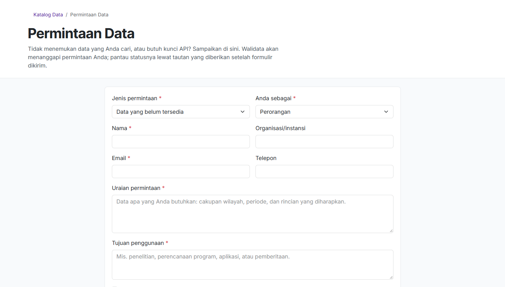

### Dashboard internal

Dashboard untuk pengguna yang login (Produsen Data, Walidata, Pembina Data, dan Admin).

### Dashboard Kependudukan
Peta kepadatan penduduk per kecamatan yang bisa dibuka sampai tingkat desa/kelurahan, lengkap dengan
kartu ringkasan, panel detail, dan daftar wilayah.

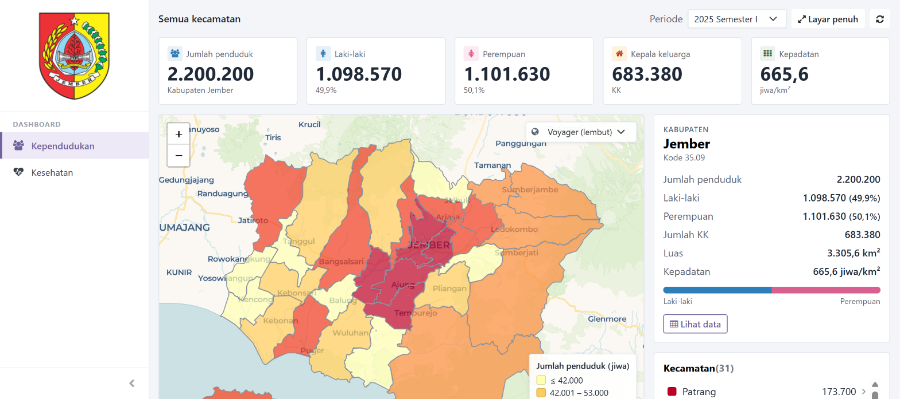

Grafik batang bertumpuk laki-laki dan perempuan per kecamatan. Klik sebuah batang untuk melihat desa/kelurahannya.

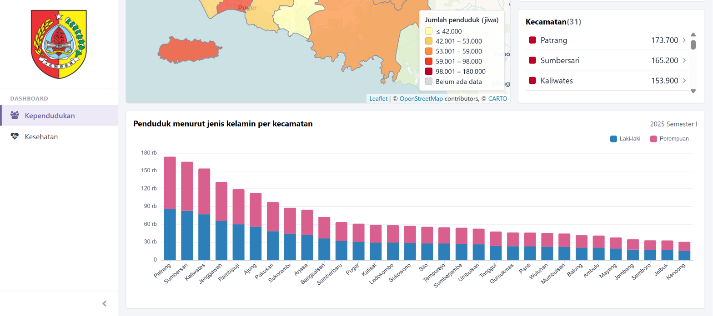

### Dashboard Kesehatan
Pilih indikator (12 SPM, imunisasi dasar lengkap, stunting, kematian ibu dan bayi, DBD), bulan, dan cara
hitung bulanan atau kumulatif. Peta memberi warna wilayah menurut capaian dan menandai lokasi puskesmas.

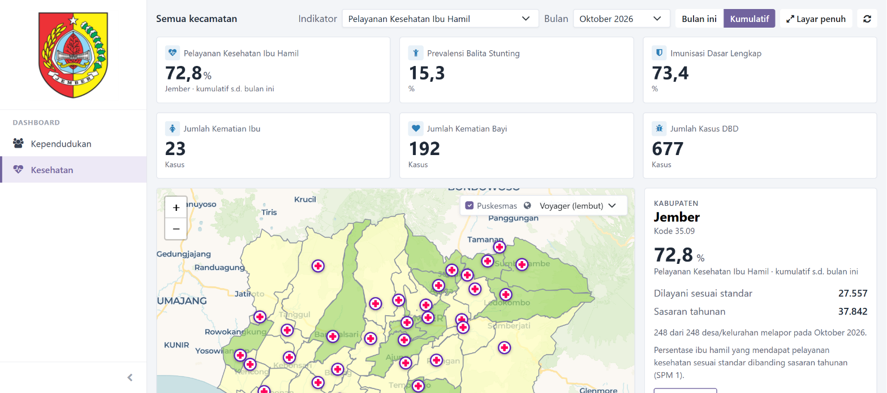

Klik penanda puskesmas untuk melihat jendela infonya, lalu **Lihat detail data** untuk membuka rekap
bulanannya.

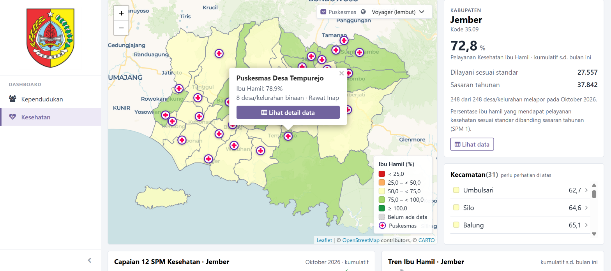

Capaian 12 Standar Pelayanan Minimal dan tren bulanan indikator yang dipilih.

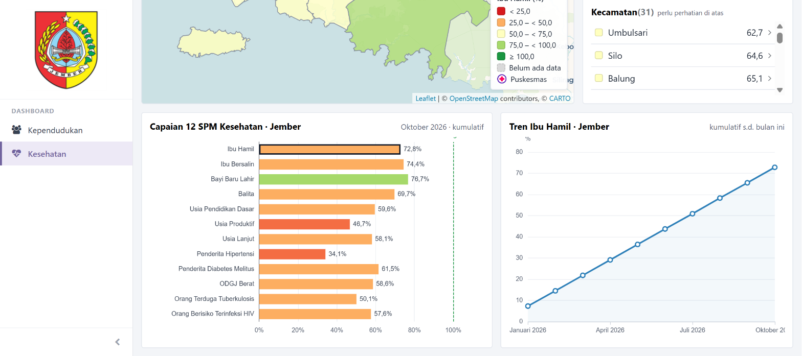

### Dashboard Pendidikan
Pilih indikator (ketersediaan, mutu layanan, partisipasi, keberlanjutan), semester, dan jenjang. Peta
memberi warna wilayah menurut nilai indikator. Saat masuk ke satu kecamatan, satuan pendidikannya tampil
sebagai titik yang digabung otomatis bila berdekatan; klik titik untuk melihat info sekolah. Grafik
menampilkan APK dan APM per jenjang serta tren antarsemester.

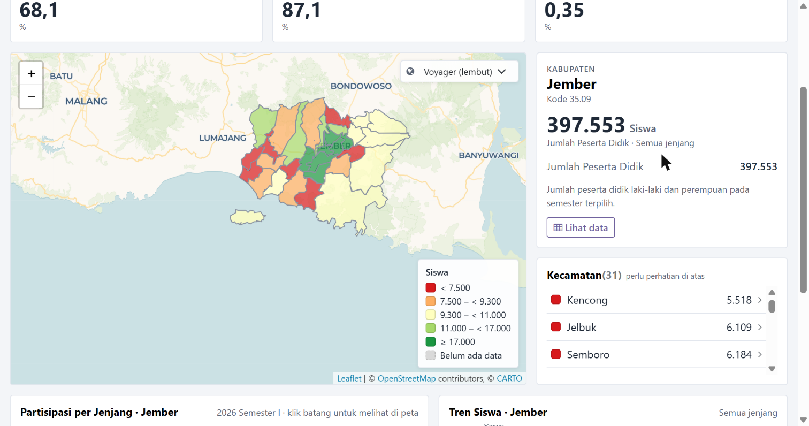

Di dalam satu kecamatan, satuan pendidikan tampil sebagai titik yang digabung menjadi lingkaran berangka
bila berdekatan.

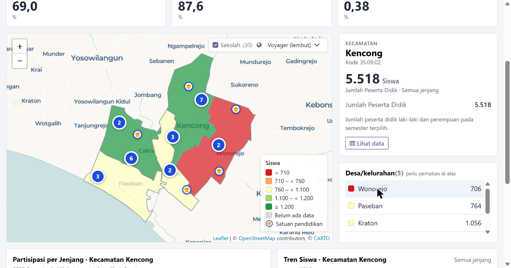

Klik sebuah titik untuk melihat info sekolah, lalu **Lihat detail data** untuk membukanya.

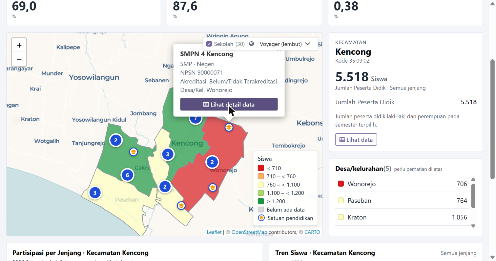

Angka partisipasi kasar (APK) dan murni (APM) per jenjang, serta tren jumlah peserta didik per semester.

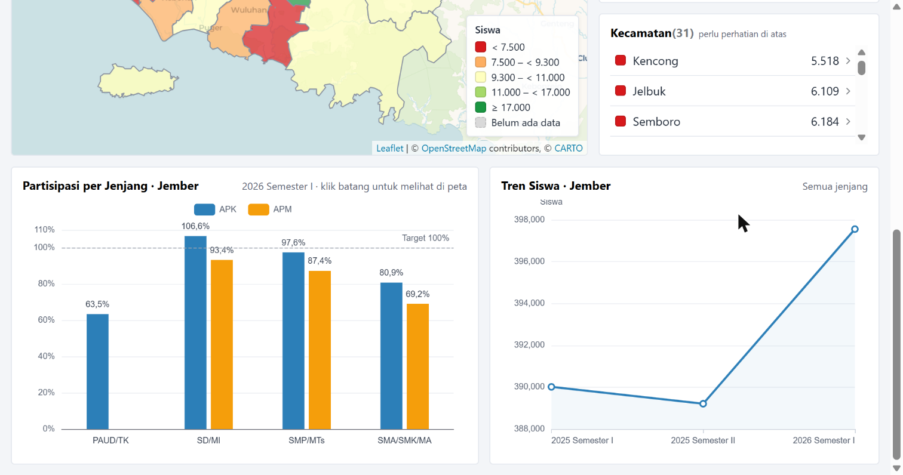

## Fitur utama

- **Alur Satu Data yang sederhana.** Produsen Data mengisi laporan, Walidata memeriksa, dan hanya
  data yang sudah diterbitkan yang tampil di dashboard. Data yang sedang diperiksa atau sudah terbit dikunci.
- **Dashboard peta per sektor.** Peta choropleth kabupaten → kecamatan → desa/kelurahan, kartu ringkasan,
  grafik, dan titik fasilitas yang digabung otomatis bila berdekatan dengan jendela info, dengan sidebar
  untuk berpindah antarsektor.
- **Tata kelola data.** Daftar Data dengan metadata selaras data.go.id, urusan pemerintahan,
  Forum Satu Data, jadwal pemutakhiran, dan penilaian ketepatan waktu Produsen Data.
- **Editor batas wilayah.** Geser, tambah, dan hapus titik batas desa/kecamatan langsung di peta.
- **Data terbatas.** Indikator sensitif hanya disajikan sampai tingkat yang ditetapkan, misalnya kecamatan.
- **Portal publik.** Katalog, dashboard tematik, unduhan CSV/Excel/JSON, API baca, statistik data populer,
  dan formulir permintaan data. Hanya data terbit dan berstatus terbuka, paling rinci per kecamatan.
- **Tanpa layanan luar.** Leaflet dan ECharts disertakan secara lokal, tidak ada pemuatan dari CDN.

## Modul

| Modul | Isi |
|---|---|
| `satu_data` | Modul inti: wilayah (kecamatan, desa/kelurahan, batas peta GeoJSON dan editornya), periode data, instansi, Daftar Data berikut metadata, Forum Satu Data, laporan dan pemeriksaan Walidata, peran akses, kerangka dashboard dengan sidebar per sektor |
| `satu_data_kependudukan` | Laporan semester penduduk per desa (laki-laki, perempuan, KK, kepadatan), dashboard peta penduduk dengan grafik laki-laki/perempuan |
| `satu_data_kesehatan` | Fasilitas kesehatan dan wilayah kerja puskesmas, laporan bulanan dan laporan sasaran tahunan per desa, 21 indikator (12 SPM, imunisasi dasar lengkap, stunting, kematian ibu/bayi, DBD), dashboard peta dengan titik puskesmas |
| `satu_data_pendidikan` | Master satuan pendidikan (NPSN, jenjang, status, akreditasi, koordinat), penduduk usia sekolah tahunan, laporan semester per desa dan jenjang (PAUD/TK, SD/MI, SMP/MTs, SMA/SMK/MA; madrasah dihimpun bersama dengan Kemenag sebagai Produsen Data vertikal), 18 indikator (jumlah sekolah/siswa/guru, rasio murid per guru, kondisi ruang kelas, kualifikasi dan sertifikasi guru, APK/APM, putus sekolah, melanjutkan), dashboard peta dengan titik satuan pendidikan |

| `satu_data_portal` | Portal publik di website Odoo: beranda, katalog Daftar Data, halaman data (tabel, grafik, metadata), dashboard tematik per topik, unduhan CSV/Excel/JSON, API baca `/api/satu-data/v1`, kunci API opsional, statistik kunjungan dan unduhan, formulir permintaan data, halaman Tentang, serta pengumuman portal |

Modul sektor bergantung pada `satu_data`. Modul inti bisa dipasang tanpa modul sektor. Portal publik
bergantung pada `satu_data`, `website`, dan `portal`, dan memakai nilai yang dihitung modul sektor yang
terpasang (angka di portal sama persis dengan dashboard internal).

## Alur kerja

Setiap sektor memakai satu pola: **satu laporan per periode** dengan tiga status,
**Diisi → Diperiksa → Terbit**.

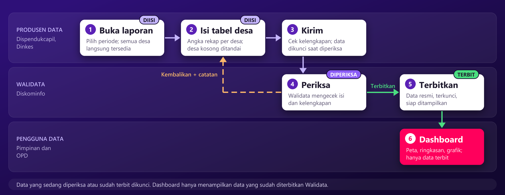

1. **Buka laporan.** Produsen Data memilih periode dan langsung mendapat baris semua desa/kelurahan.
2. **Isi tabel desa.** Angka diisi langsung di tabel, dan desa yang masih kosong ditandai.
3. **Kirim ke Walidata.** Sistem memeriksa kelengkapan. Laporan tetap bisa dikirim walau ada desa kosong,
   tetapi Walidata melihat jumlahnya dan desa itu tidak tampil di dashboard.
4. **Periksa.** Walidata menerbitkan, atau mengembalikan dengan catatan wajib. Laporan yang dikembalikan
   kembali ke status Diisi dan catatan Walidata tampil di bagian atasnya.
5. **Terbit.** Data resmi dan terkunci, lalu tampil di dashboard.

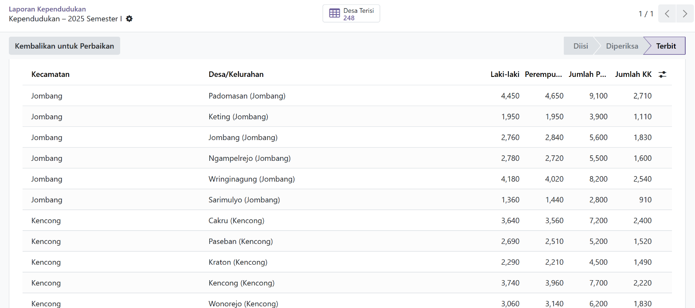

### Peran

| Peran | Tugas |
|---|---|
| Pengguna Data | Melihat dashboard dan data |
| Produsen Data (per sektor) | Mengisi dan mengirim laporan sektornya |
| Walidata | Memeriksa, menerbitkan, atau mengembalikan laporan semua sektor |
| Pembina Data | Melengkapi standar data dan metadata |
| Admin | Mengatur wilayah, periode, instansi, dan pengguna |

## Portal publik

Modul `satu_data_portal` menyebarluaskan data tanpa login, mengikuti tahap penyebarluasan Satu Data Indonesia.

**Aturan publik.** Hanya Daftar Data yang aktif, berstatus akses *Terbuka*, tidak dihentikan, dan sudah punya
laporan terbit. Angka paling rinci per kecamatan (atau hanya kabupaten/kota bila tingkat penyajiannya
demikian); desa tidak pernah dirinci. Nilainya dihitung modul sektor dengan rumus dashboard internal,
sehingga angka portal dan dashboard selalu sama.

| Halaman | Isi |
|---|---|
| `/beranda` | Pencarian, ilustrasi, angka kunci, cara memakai data, data terbaru dan populer |
| `/data` | Katalog: pencarian, saringan Produsen/topik/urusan/tahun, urut terbaru/populer/abjad |
| `/data/<kode>` | Grafik, tabel per periode dan kecamatan, metadata, unduhan, dan alamat API |
| `/dashboard` | Dashboard tematik per topik: peta kecamatan, peringkat, dan tren |
| `/permintaan` | Formulir permintaan data atau kunci API, dengan halaman status berbasis tautan rahasia |
| `/data/api` | Dokumentasi API |

**API baca** `/api/satu-data/v1` (JSON, CORS terbuka): daftar data, metadata, nilai per wilayah dan periode,
wilayah, dan referensi. Tanpa kunci dibatasi per alamat IP. Instansi lain dapat meminta **kunci API**
(header `X-API-Key` atau `Authorization: Bearer`) untuk batas permintaan yang lebih longgar. Kunci tidak
membuka data tertutup, hanya hash-nya yang disimpan, dan kunci lengkap tampil sekali saat dibuat.

**Penanganan permintaan.** Walidata menangani permintaan di menu **Tata Kelola › Permintaan Data**
(proses, selesai, atau tolak dengan tanggapan yang dibaca pemohon) dan membuat kunci di **Kunci API**.
Statistik kunjungan dan unduhan per data tersimpan sebagai angka agregat tanpa data pengunjung.

**Keamanan.** Formulir memakai token CSRF, kolom jebakan robot, tanda waktu bertanda tangan, batas kiriman per
IP, dan batas panjang isian; keluaran selalu di-escape. Halaman status hanya terbuka dengan token acak dan
tidak menampilkan data kontak pemohon. Unduhan CSV dilindungi dari injeksi rumus. Tes keamanannya ada di
`satu_data_portal/tests/test_keamanan.py` (tag `satu_data_keamanan`).

**Pengaturan.**
- Bahasa Indonesia, beranda `/beranda`, dan palet warna logo diterapkan **sekali** saat modul dipasang;
  sesudahnya bebas diubah lewat penyunting website (warna utama = *Color 1*).
- Parameter sistem `satu_data_portal.pengumuman` menampilkan pengumuman di atas portal, misalnya penanda
  bahwa data masih contoh. Kosongkan untuk menghilangkannya.

## Pemasangan

1. Salin kelima folder modul ke folder `addons` Odoo 19.
2. Aktifkan mode pengembang, perbarui daftar aplikasi, lalu pasang **Satu Data - Kependudukan**,
   **Satu Data - Kesehatan**, dan/atau **Satu Data - Pendidikan** (modul inti ikut terpasang), serta
   **Satu Data: Portal Publik** bila ingin portal publik (memasang `website` dan `portal`, dan butuh pustaka
   Python `xlsxwriter` untuk unduhan Excel).
3. Untuk mencoba, buat database dengan *data demo* (wilayah, penduduk, data kesehatan, dan data
   pendidikan Jember). Bila konfigurasi Odoo memakai `with_demo = False`, tambahkan `--with-demo`
   saat membuat database.
4. Atur nama, logo, dan kode wilayah di **Konfigurasi › Identitas Wilayah**.

> **Server yang dapat diakses publik: jangan memakai data demo.** Database dengan data demo Odoo memuat
> pengguna contoh (`demo` dan `portal`) dengan kata sandi bawaan yang diketahui umum. Bila sudah terlanjur,
> nonaktifkan keduanya dan acak kata sandinya, ubah *Undangan pendaftaran* ke "Hanya undangan", dan ganti
> kata sandi admin. Data demo Satu Data bersifat fiktif; tandai portal dengan parameter
> `satu_data_portal.pengumuman` selama masih memakainya.

Menjalankan tes:

```
odoo-bin -c odoo.conf -d <database> --test-enable --test-tags /satu_data,/satu_data_kependudukan,/satu_data_kesehatan,/satu_data_pendidikan,/satu_data_portal --stop-after-init
```

### Peta dasar

Peta dasar CARTO memerlukan API key (isi di Identitas Wilayah). Tanpa key, dashboard memakai
OpenStreetMap. Server tile sendiri bisa dipakai lewat parameter sistem `satu_data.url_peta_dasar`.

## Data demo

Seluruh data demo bersifat **fiktif** dan hanya contoh, bukan data resmi:

- Batas dan kode wilayah Kabupaten Jember bersumber dari
  [cahyadsn/wilayah](https://github.com/cahyadsn/wilayah) (MIT),
  [pararawendy/border-desa-indonesia-geojson](https://github.com/pararawendy/border-desa-indonesia-geojson),
  dan [cahyadsn/wilayah_boundaries](https://github.com/cahyadsn/wilayah_boundaries) (MIT).
- Angka penduduk, data kesehatan, dan data pendidikan dibangkitkan secara acak dengan pola yang masuk akal.
- Nama sekolah dan NPSN pada data demo pendidikan adalah rekaan (NPSN berawalan 9), bukan sekolah sungguhan.

## Lisensi

LGPL-3.0, sesuai Odoo. Leaflet, plugin markercluster, dan ECharts memiliki lisensinya sendiri
(lihat `satu_data/static/lib/`).
